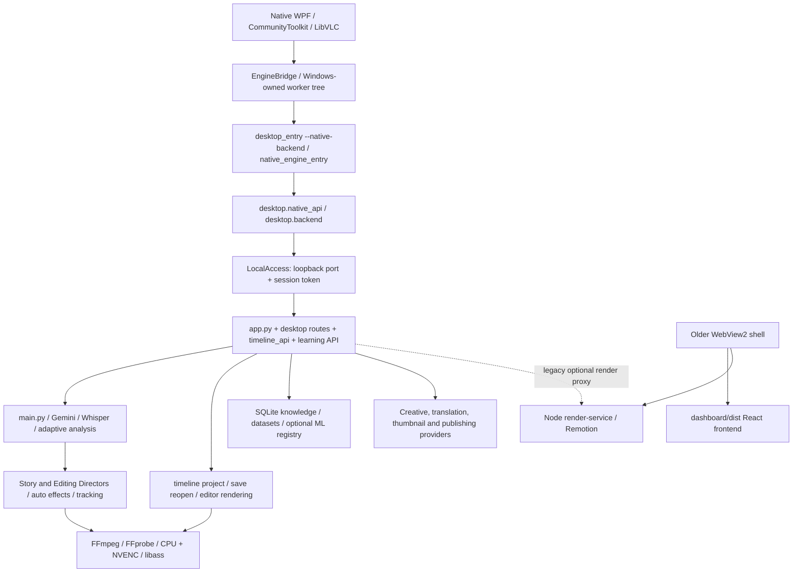

# Desktop-only cleanup — first-run audit and approval plan

Date: 2026-10-19. **Status: awaiting approval. No original source, dependency, directory or customer file has been moved or deleted.** Only new audit, backup and synthetic verification artifacts were created. No paid Gemini calls, large downloads, VPS uploads, package upgrades or Git initialization occurred.

## 1. Project size before cleanup

Logical inventory: **23,629,303,191 bytes (23.63 GB / 22.01 GiB), 125,540 files**. Links/reparse targets were not followed. There were no inventory access errors. This is a traversal snapshot, not an atomic filesystem snapshot; the audit output and baseline-build creation overlapped the traversal. It is not an allocated-disk or installer-size measurement.

| Area | Logical bytes | Classification / decision |
|---|---:|---|
| `.venv/` | 6,829,169,522 | KEEP_RUNTIME_DEPENDENCY; no uninstall proposed |
| `build/` | 6,715,466,707 | REVIEW_REQUIRED; old builds, source recovery and diagnostics intermixed |
| `OpenShorts Library/` | 6,427,478,521 | PROTECTED_USER_DATA |
| `native/` | 805,601,482 | KEEP_DESKTOP, including runtime content and current build intermediates |
| `.nuget/` | 727,378,523 | KEEP_RUNTIME_DEPENDENCY |
| `remotion/` | 691,501,007 | REVIEW_REQUIRED; preserve pending fallback migration |
| `render-service/` | 476,391,101 | REVIEW_REQUIRED; preserve pending fallback migration |
| `dashboard/` | 109,530,694 | REMOVE_WEB_ONLY/REMOVE_GENERATED with exact retained exceptions |
| `.remotion/` | 109,623,350 | KEEP_RUNTIME_DEPENDENCY/recovery; not approved for removal |

Root ZIPs, media/GIF examples, `not update/`, screenshots and logs remain out of scope. Age is not deletion evidence. The existing `.git` is protected, unchanged and was not used as the recovery mechanism.

## 2. Actual desktop dependency graph



Machine-readable evidence: `build/desktop-cleanup-audit-20261019-185359/dependency-graph.json`. It records **1,715 local Python import edges**, a conservative closure of 115 Python source files from the native/worker roots, **142 declared HTTP route records across scanned modules**, 129 native route literal references, and resource/subprocess/dynamic-import marker locations. No Python parse errors were found. These are source-analysis observations, not a claim that every conditionally imported module executes at runtime. Interpolated routes/reflection still require manual review; no deletion is authorized merely by absence from this graph.

Key dependency evidence:

- `EngineClient.StartAsync` launches the frozen native engine or Python `desktop_entry.py --native-backend`; it does not start React, Vite or a Node rendering service.
- `desktop.native_api.main` configures the existing library/profile and calls `serve(native=True)`.
- `desktop.backend.serve` mounts `dashboard/dist` **only when `native=False`**. WPF uses the authenticated local HTTP service, not the React page.
- Native Export uses `RenderCore`, existing editor-run routes, validated MP4 delivery and FFmpeg; real native smoke exports succeeded without a Node/Vite startup path.
- WPF project references are Core, Infrastructure and EngineBridge, with CommunityToolkit/Microsoft extensions and LibVLC. No WPF WebView2 reference was found.
- `desktop.windows_shell` is the older browser host. It loads `dashboard/dist`, uses pywebview/pythonnet/WebView2, and can start the Node renderer. `start_desktop.vbs` and the no-argument Python entry currently reach it, so launcher neutralization is a prerequisite for quarantining the frontend.
- `tests/test_desktop.py` imports the old shell's `InstanceLock`. Thus the shell file and its Python dependencies are **not** proposed for deletion until that test's behavior is safely migrated. The native lock compatibility implementation/test is also retained.
- WPF creative, gallery, thumbnail, translation and publishing features call existing `app.py` handlers. `s3_uploader.py` is imported by `app.py`; boto3 and related helpers must stay. A route is not web-only merely because it uses HTTP.
- `cloud/config.py` is referenced from shared partial-processing logic; cloud/account/provider tests also reference cloud code. Cloud package deletion would be premature. Desktop bootstrap forces billing off, but conditional reachability does not prove safe package removal.

## 3. Standalone web components identified

The React/Vite/Tailwind frontend is under `dashboard/`; its dependencies and generated output are `dashboard/node_modules/` and `dashboard/dist/`. It includes browser routes, SEO generation, static website resources and an Nginx configuration. Root `start_windows.bat` starts both a public development backend and frontend; `start_frontend_windows.bat` starts Vite.

The older WebView shell, its packaging under `packaging/windows/`, and its Node renderer are separate from the native WPF UI. They are not blindly deleted because tests, fallback APIs, shared license-inventory helpers and legacy launchers still refer to them.

## 4. Exact proposed removal/quarantine scope

**Phase 1: 9,493 files, 108,816,388 bytes (108.82 MB / 103.78 MiB).** Approval applies to individual manifest members, **not recursive deletion of the entire `dashboard/` tree**. Retained exceptions must survive. No permanent purge is proposed.

| Proposed group | Files | Bytes |
|---|---:|---:|
| `dashboard/node_modules/` selected dependency files | 9,302 | 99,850,808 |
| `dashboard/dist/` selected generated frontend output | 69 | 5,764,794 |
| `dashboard/public/` web resources | 24 | 1,795,622 |
| `dashboard/seo/` standalone site material | 5 | 283,401 |
| `dashboard/src/` browser source, except retained fixtures/notices | 80 | 873,119 |
| `dashboard/` top-level Vite/npm/SEO/Nginx files | 11 | 247,638 |
| `start_frontend_windows.bat`, `start_windows.bat` | 2 | 1,006 |

The authoritative per-file list is `build/desktop-cleanup-audit-20261019-185359/cleanup-manifest.json`. Every candidate includes original relative path, exact size, SHA-256, classification, purpose, dependency evidence, removal risk and verified archive member. `removal-summary.json` groups these exact entries; `file-inventory.jsonl` classifies every inventoried file.

Protected exceptions inside the frontend:

- `dashboard/src/remotion/lib/captions.ts`
- `dashboard/src/remotion/compositions/Subtitles.tsx`
- `dashboard/src/remotion/lib/types.ts`
- `dashboard/src/components/DeleteAccountCard.jsx`
- **228 exact license/notice/copying files**, enumerated in `protected_exceptions`, retained in place and backed up.

The three Remotion files are read by the existing caption parity test. The account component is read by the account-erasure regression. Keeping these temporarily avoids deleting regression coverage or silently changing assertions. They do not require a running frontend. Runtime `fonts/`, `assets/`, LibVLC, FFmpeg components, caption presets and video templates remain untouched.

## 5. Approved files actually quarantined or removed

**None. Approval is pending.** The task explicitly requires: “STOP and request my approval before deleting or moving files.” All originals remain present.

## 6. Retained components and reasons

All native source, tests, shared engine modules, local IPC handlers, Gemini configuration/key precedence, protected credential stores, adaptive analysis, Whisper, scene/subject tracking, editing effects, timeline serialization, SQLite ML knowledge, approved model data, settings, profiles, media, caches/checkpoints and download history are protected.

Remotion and `render-service` remain REVIEW_REQUIRED. WPF does not issue a direct `/api/render` call in the reviewed sources, but shared `app.py` still exposes those proxy handlers and regression tests exercise cancellation/ownership. Existing legacy fallback source also references the renderer. This phase does not remove its npm dependencies, Chrome assets or cache. A separate explicit fallback retirement and contract migration is needed before removal.

`cloud/`, Alembic, `requirements-billing.txt`, MCP/CLI adapters, `ops/`, `not update/`, archived ZIPs and historical generated builds are REVIEW_REQUIRED. None is selected for deletion. NuGet packages and native DLLs remain unchanged. Deno and yt-dlp remain because the desktop downloader uses them. FastAPI, Uvicorn, multipart and httpx remain because they implement native IPC/import/provider workflows.

## 7. Verified backup location

`.desktop-cleanup-recovery/20261019-185359/pre-cleanup.zip`

Verified archive: **35,412,131 bytes**, **9,751 members**. Each member was read back and SHA-256 checked. This includes the removal candidates, all retained attribution/test exceptions, and original source/configuration files contemplated for edits. The ZIP SHA-256 is recorded in both manifests; credentials and customer libraries are not copied.

Host free-space check before backup: approximately 108.3 GB available, comfortably above the conservative requirement. Backup capacity and verification succeeded.

An independent restoration-tool verification completed with: `backup_verified=true`, `members=9751`, `missing=0`, `changed=0`, `restored=0`. This confirms all snapshotted originals still match the verified backup. A future execution must recheck those hashes immediately before any move; changed files require a refreshed proposal/backup.

## 8. Quarantine location

Reserved, not populated: `.desktop-cleanup-recovery/20261019-185359/quarantine/` with original relative paths. This recovery area is outside the selected cleanup targets and explicitly excluded from recursive cleanup inventory. It is on the same drive, so quarantine alone does **not** recover drive space. A separate later purge approval is required. Never add this directory to generated-build cleanup.

## 9. Proposed source/dependency changes — not applied

Review `build/desktop-cleanup-audit-20261019-185359/proposed-edits.patch` and `proposed-modifications.json`:

1. `desktop/backend.py`: retire `native=False` browser serving and remove the dashboard HTML mount. Keep the native loopback API, worker dispatch, media routes and session boundary.
2. `desktop_entry.py`: preserve all managed worker/native modes; make a no-argument launch explain how to open WPF instead of importing the old browser shell.
3. `start_desktop.vbs`: redirect the compatibility launcher to `start_wpf.vbs`.
4. `packaging/windows/build.py`: parameterize its shared license-inventory helper so the native build can omit retired web package inventory without copying frontend material.
5. `packaging/wpf/build.py`: call that inventory helper in native-only mode.

No clipping, Gemini prompting/routing, rendering, timeline, database, manual override or model behavior changes are proposed. No Python/NuGet/Remotion dependency uninstall is included in Phase 1. Release documentation and a later legacy-launcher migration can follow after these exact changes pass regressions; the old browser packaging command must not be used once its dashboard inputs are quarantined.

The proposed patch is a review artifact only. It has not been applied or tested as the post-cleanup product yet. Production sources were not changed during this first run.

## 10–11. Size after cleanup and recovered space

Actual removed/quarantined bytes: **0**. Actual recovered drive space: **0**. Original file payloads are unchanged; new backups, builds and synthetic diagnostic files add temporary overhead.

Projected reduction of the active project tree, excluding the recovery area, after the approved move: **108,816,388 bytes**. The arithmetic projection against the traversal snapshot is 23,520,486,803 bytes, but this is not a fresh post-cleanup measurement. Same-drive quarantine preserves the files' storage allocation; do not claim it frees 108.8 MB on the drive. No installer was produced before or after cleanup, so compressed installer-size savings are **unmeasured**.

WPF packaging already stages explicit native assets/models/FFmpeg resources rather than the whole repository. Removing frontend files from the source tree alone does not imply equivalent installer shrinkage. Its reused license-inventory helper currently scans web npm trees; the proposed parameter preserves native notices while avoiding that unnecessary scan. Full release packaging is blocked by missing `packaging/windows/FFMPEG-SOURCE-OFFER.txt` and `packaging/wpf/THIRD-PARTY-NOTICES.txt`. No licensing check was bypassed, and no installer-size estimate was invented.

## 12. Desktop build results

WPF Release build: **passed, zero warnings, zero errors** into `build/desktop-cleanup-baseline-native/`. Existing working launchers/builds were not overwritten. Native .NET tests: **60 passed, zero failed/skipped**. TRX: `build/desktop-cleanup-baseline-native-tests/desktop-cleanup-baseline.trx`.

## 13. Python baseline results and existing failures

**448 tests: 442 passed, 6 failed, zero skipped/errors**, approximately 95.54 seconds. XML: `build/desktop-cleanup-baseline.xml`. No paid APIs were called. Twelve existing PySceneDetect `get_frames()` deprecation warnings were recorded.

Failures found **before any cleanup**:

| Test | Observed mismatch |
|---|---|
| `test_requested_env_keys_are_allowlisted_and_primary_dpapi_is_preserved` | Old assertion expects saved UI primary; current intentional `.env` precedence selects the explicit local key. Dedicated current key-precedence tests pass. |
| `test_completed_steps_survive_long_logs_and_chapter_progress_is_measured` | Old exact-dictionary assertion omits the current `completed` chapter count; actual stage percentage is correct. |
| `test_adaptive_upload_reused_across_operations_for_same_key` | Fixture is 3 MiB; current source threshold permits inline video up to 4 MiB, so the expected upload never occurs. |
| `test_expired_uploaded_reference_is_replaced_once` | Same threshold/fixture mismatch prevents entering the Files API branch. |
| `test_chapter_sized_proxy_uses_uploaded_reference_from_first_attempt` | Same 3 MiB fixture versus 4 MiB inline threshold. |
| `test_reference_generation_retry_reuses_one_upload` | Same threshold/fixture mismatch. |

These test-contract discrepancies must be reconciled explicitly before declaring a green final cleanup regression. They were not “fixed” by changing provider logic or deleting tests in this audit-only pass. The current 4 MiB threshold was observed in the actual source; earlier reports mentioning 2 MiB are stale for this baseline.

Passing coverage includes managed EngineBridge security/startup routes, credential precedence, imports/transcript/scene fixture paths, native media import, adaptive/legacy Gemini mocked requests, Auto Edit, ML storage/retrieval/training guards, project save/reopen, timeline APIs, captions and local render/export compatibility.

## 14. Native acceptance results

Fresh generated media and separate temporary libraries were used; no customer library/settings reset occurred.

- `build/desktop-cleanup-native-editor/visual-result.json`: native playback, fullscreen reparenting, foreground overlays, responsive panels and image preview passed.
- `auto-edit-result.json`: effect undo/redo, regeneration preserving a manual intensity override, save/reopen and rendered preview passed; provider calls 0.
- `learning-result.json`: native learning panel, explicit feedback, duplicate guard, privacy toggles and insufficient-data model-training guard passed; provider calls 0. Synthetic feedback remained in the isolated library; no production model was promoted.
- `build/desktop-cleanup-native-clipper/clipper-result.json`: import-to-ready page, mocked generation progress, cancellation, background navigation, partial results, real playback, native timeline, real 1080 × 1920 batch exports, per-item retry, preferences, inline styling, updated preview and duplicate isolation passed; paid requests 0.

The clipper harness deliberately simulates a worker disconnect and writes `generation-transition-error.txt`; the final acceptance result confirms recovery. That intentional error artifact is not an unexpected startup failure.

No React/Vite development server or Node render service was launched by either native harness. This validates the exercised native paths, not every dormant optional endpoint. Repeat the same checks after approved cleanup.

## 15. CPU/NVENC export baseline

Fresh three-second 640 × 360 generated test pattern, existing render runtime:

| Requested | Actual encoder | Time | Duration | CPU fallback |
|---|---|---:|---:|---|
| CPU | `libx264` | 0.406 s | 3.000 s | No |
| NVIDIA | `h264_nvenc` | 0.407 s | 3.000 s | No |

Evidence: `build/desktop-cleanup-export-baseline/result.json`. This tiny fixture is a functionality check, not a long-video performance claim. It uses no external provider and no downloaded source.

## 16. Web technologies that must remain

Local authenticated FastAPI/Uvicorn HTTP IPC, media streaming, native import endpoints, JSON contracts and httpx provider calls remain essential. Remote API integrations selected by native features remain. Native playback uses LibVLC; WebView2 is not a current WPF UI dependency, but the old shell/testing source remains until its lock regression and compatibility launcher are migrated. Remotion/Node fallback code remains REVIEW_REQUIRED. HTTP alone is not grounds for removal.

## 17. Remaining risks and approval boundaries

- Full desktop-only cleanup is not complete after this conservative Phase 1. Cloud/shared route separation, old shell test migration, npm renderer retirement and historical build pruning need additional evidence and approval.
- The six baseline failures prevent an unconditional final “all regression tests green” claim.
- Some clients/build scripts/docs still reference the old product; the exact launcher/backend patch must be applied alongside frontend quarantine. Do not remove only the directory and leave the browser launcher active.
- No quarantine/purge or dependency uninstall is authorized yet. Unknown, REVIEW_REQUIRED and protected paths are excluded.
- Final post-cleanup measurements, release bundle inspection, installer build and upgrade acceptance remain pending. Missing attribution/source-offer files block redistribution.
- Retained frontend fixture/notices may leave a small inert `dashboard/` directory. Its existence does not mean a frontend application must remain active; do not recursively delete it without preserving the exceptions.

## 18. Restoration procedure

Backup instructions are also in `.desktop-cleanup-recovery/20261019-185359/RESTORE.md`. The new recovery helper performs **verification only by default**:

```powershell
.venv/Scripts/python.exe tools/desktop_cleanup_restore.py .desktop-cleanup-recovery/20261019-185359/manifest.json
```

After a separately approved cleanup, stop only owned desktop jobs, verify archive and per-file hashes, then restore missing originals with explicit `--restore`. The helper validates paths and rejects changed existing files rather than silently overwriting later edits. Review any such conflicts manually, preserving both versions. Quarantined files retain their original relative paths and can also be restored after hash verification. Do not purge the recovery ZIP or quarantine without separate approval.

If validation fails after an approved move, restore the affected dependency immediately, record it and remove that path from further cleanup scope. User data/credentials are never cleanup restoration targets.

## 19. Recommended maintained structure

Keep `native/`, `desktop/`, `adaptive_analysis/`, `learning/`, shared root Python engine modules, `assets/`, `fonts/`, `tests/`, `benchmarks/`, `tools/`, `docs/` and native release packaging in their existing locations. Keep the existing library/data/cache and credential policies. Do not relocate the whole Python engine for appearance. Preserve a single Gemini integration, the current supported local render path, existing fallbacks and serialization versions.

**Approval requested:** only the 9,493 individually listed Phase 1 quarantine entries plus the five-file proposed patch. This authorizes no permanent deletion, no unlisted directory removal, no customer-data changes and no ML/Gemini/rendering rewrite. Stop here until the user approves the exact manifest.
